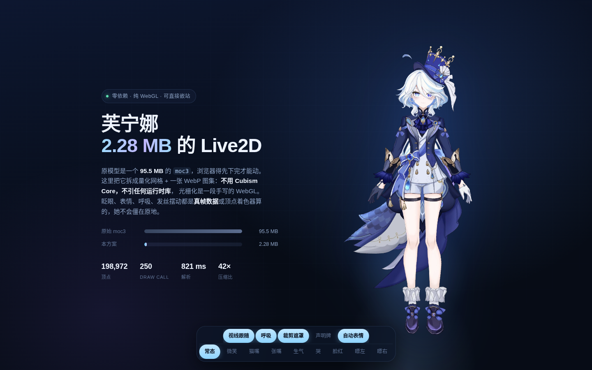

# FurinaMini — 2.32 MB 的 Live2D 芙宁娜



> 在线演示：`index.html`（纯静态，根目录即是站点）

把一个 **95.5 MB** 的 Cubism `moc3` 模型压成能放进网站的 **2.32 MB**，
**不用 Cubism Core，不引任何运行时库**，光栅化是一段手写的 WebGL。
她会呼吸、眨眼、瞟视线、换表情、裙尾飘动——表情用的是**真实采样出来的顶点帧 + 部件透明度**，不是缩放抖动。
按住模型可以**拖动**，双击回到原位。

**加载策略**：GitHub Pages 国内直连很慢（实测 ~10KB/s），页面会自动按
「本站 → Cloudflare CDN（testingcf.jsdelivr.net）→ GitHub Pages → jsDelivr」
的顺序尝试加载，boot 界面实时显示下载百分比；`?line=cdn|jsdelivr|github`
可强制指定线路。mesh/atlas/wand 三个文件流式统计进度，资源放到哪个目录
（`furina-mini/` 或 `dist/`）都能自动探测。

| | |
|---|---|
| 网格数据 | `furina-mesh.bin` · 1.58 MB（gzip 845 KB） |
| 图集 | `furina-atlas.webp` · 666 KB（2048×2048，预乘 alpha + bleed） |
| 渲染器 | `furina-mini.js` · 38 KB（gzip 12 KB） |
| 权杖贴图 | `furina-wand.webp` · 37 KB（官方立绘抠图，可开关/拖动） |
| **合计** | **2.32 MB** / gzip ≈ 1.48 MB |

原始模型（`furina.moc3` 95.5 MB + `texture_00.webp` 2.7 MB + motions）合计 **93.8 MB**，
压缩比 **41×**。体积能压这么大，是因为 moc3 里 **96.8% 的字节是 344 个参数 × 7156 组 keyform 的顶点变形数据**，
而这些数据在网页里很少会同时被驱动。

---

## 用法

```html
<div id="furina" style="width:320px"></div>

<script src="./dist/furina-mini.js"></script>
<script>
  FurinaMini.mount('#furina', { base: './dist/' });
</script>
```

`mount()` 返回 Promise，解析出实例：

```js
FurinaMini.mount('#furina', { base: './dist/' }).then(function (m) {
  console.log(m.vertCount);      // 198,972
  console.log(m.runV0.length);   // 250
  console.log(m.frameCount);     // 11
});
```

> 必须用 `http(s)` 打开。`file://` 下 `fetch` 和 `` 都会被 CORS 拦掉。

**拖动**：按住模型拖拽即可移动，松手停在原地，双击回到原位。手机上同样生效（pointer events）。

---

## 选项

| 选项 | 默认 | 说明 |
|---|---|---|
| `base` | `''` | 资源目录前缀 |
| `mesh` / `atlas` | `furina-mesh.bin` / `furina-atlas.webp` | 也可以换自己的文件 |
| `size` | `320` | 初始像素宽；挂载后由容器宽度接管 |
| `dpr` | `min(devicePixelRatio, 3)` | 后端缓冲倍率，retina 下够锐 |
| `maxPixels` | `3200000` | 画布总像素上限，超了自动降 dpr |
| `draggable` | `true` | 按住拖动、双击回位 |
| `follow` | `true` | 鼠标视线跟随（跨页面监听，可运行时改 `m.o.follow`） |
| `idle` | `true` | 呼吸 + 发丝/裙摆摆动 + 体态摇曳 + 呆毛物理 + 眨眼 + 自动表情 |
| `ahoFree` | `true` | 呆毛解除原模型遮罩、完整显示（根部搭在头发上）；`false` 恢复原始裁剪 |
| `wand` | `true` | 权杖贴图层（原模型没有权杖网格）；`setWand(false)` 或按钮可关 |
| `autoExpr` | `true` | 空闲时自动换表情/瞟视线，设 `false` 只响应手动调用 |
| `autoExprList` | `[5,6,10,1,2,3,4,5,8]` | 自动表情的帧索引池 |
| `clip` | `true` | 模板缓冲裁剪，还原眼睛 / 衣摆的遮罩 |
| `hidePlate` | `true` | 隐藏作者贴在胸口的“仅供娱乐，禁止盈利”告示牌 |
| `hide` | `null` | 额外隐藏的 drawable 下标数组 |
| `minAlpha` | `0.999` | 低于此不透明度的部件视为过渡态残留，不绘制 |
| `useBlend` | `3` | 位掩码：`1` 启用加算、`2` 启用正片叠底 |
| `drawMaskTargets` | `true` | 遮罩体本身也要绘制 |
| `frames` | `null` | 帧名表，用于 `setExpression('smile')` 这类字符串调用 |

实例方法：

```js
m.setExpression('smile');      // 或 m.setExpression(5)，第二个参数是保持毫秒数
m.setExpression(0);            // 回到常态
m.blink();                     // 立刻眨一下
m.rebuild();                   // 改了 hide / hidePlate 之后重建可见几何（约 30 ms）
m.start();                     // 手动启动 rAF 循环（idle:false 时用）
m.destroy();                   // 解绑监听、释放 GL 上下文、移除节点
```

帧索引：

| 0 | 1 | 2 | 3 | 4 | 5 | 6 | 7 | 8 | 9 | 10 |
|---|---|---|---|---|---|---|---|---|---|---|
| blink | eyeLeft | eyeRight | eyeUp | eyeDown | smile | catMouth | mouthOpen | angry | cry | blush |

---

## 数据是怎么来的

```
furina.moc3 (95.5 MB)
   │  Cubism Core 在浏览器里解出每个 drawable 的真实顶点
   ▼
851 可见 + 140 掩码 = 991 drawable  →  83,418 顶点 / 354,510 索引
   │  位置 int16（scale 32767/1.5），UV uint16，索引改局部偏移
   │  再单独采样 11 组表情参数，只存"真的动了的" 137 个 drawable
   │  每帧再存一张「部件不透明度覆盖表」（腮红/眼泪/嘴型这类靠显隐切换的表情）
   ▼
furina-mesh.bin (1.58 MB)
```

采样时不是直接读 moc3 —— `moc3` 的默认参数帧姿态是歪的（多个参数默认 `-30`），
头部偏斜、腿部被拉成条带。正确做法是先用官方 `cubism4` 运行时跑 3.5 秒，
让 idle motion 和 physics 把参数推到稳定值，再读 `model.drawables.vertexPositions`。

表情帧同理：改参数后重新读顶点和不透明度。**两类表情数据缺一不可**——
`blush` / `cry` / `catMouth` 的主要表现是部件显隐（腮红贴片、眼泪贴片、嘴型贴图切换），
光存顶点位移根本看不出来。

文件格式（小端，`FUR4`）：

```
'FUR4' | N:u32 | vTot:u32 | iTot:u32 | canvasW:f32 | canvasH:f32 | sy:f32 | frameCount:u32
N × { vc:u16, ic:u16, ro:u16, ti:u16, op:u8, flags:u8, maskCount:u8, maskRef(u16 × n) }
4 字节对齐
vTot × { x:i16, y:i16 }        位置
vTot × { u:u16, v:u16 }         UV
iTot × u16                     索引（每个 drawable 内部从 0 开始）
--- 动画扩展 ---
K:u8 | M:u16 | M × drawableIndex:u16
K × 动态顶点数 × { x:i16, y:i16 }   每帧的绝对位置
--- 不透明度覆盖扩展（FUR4 新增）---
u8(1)
K × { count:u16, count × { drawableIndex:u16, opacity:u8 } }
```

---

## 渲染管线

每帧做的事：

1. **筛选部件** —— `opacity ≥ minAlpha` 或「被任一帧的不透明度覆盖表命中」的才算可见。
2. **合并 run** —— 相邻且「混合模式 + 掩码集合 + 是否动态 + 是否被覆盖」相同的部件并成一个批次。
   被覆盖的部件单独成 run，绘制时通过 `uAMul` 单独调 alpha。
3. **烘焙** —— 展开成非索引三角流，交错布局 `[x, y, u, v, a]`（20 字节）。
4. **绘制** —— 每个 run：要裁剪就先用模板缓冲画掩码，再 `stencilFunc(NOTEQUAL, 0)` 画本体。

绘制顺序完全沿用模型原始的 `renderOrder`。

### 动画怎么做的

**表情和眨眼**是真实帧：加载时把每帧的位置减去基准帧，转成**位移**存进第二个
`ARRAY_BUFFER`。着色器里直接相加：

```glsl
vec2 p = aPos + aBlink * uBlink + aExpr * uExpr;
```

位移相加让两组帧能**同时叠加**：眨眼只动眼睛、微笑只动嘴眉，「笑着眨眼」不会互相覆盖。

**部件显隐类表情**（腮红/眼泪/嘴型贴图）走不透明度覆盖：`uAMul` 随表情淡入淡出插值，
腮红贴片从透明渐显，和顶点位移同时生效。

**呼吸**只让胸腔起伏（横向扩张 + 纵向位移的局部权重），**整体尺寸恒定**——
不然整只模型会「一胀一缩」。

**裙尾飘动**在顶点着色器里做：腰线以下权重线性增强，但只有离中线足够远的「裙幅」
（裙摆两侧、大衣垂摆）才吃权重——腿在中间完全不动，不会穿模；下摆以下权重渐隐，
大衣垂摆不受下摆限制、可以一直飘到最低。两条不同频率的正弦按 y 做相位差，
裙尾呈现波浪状的布料摆动。

**体态摇曳**：整只上身（躯干 + 手臂 + 头）绕髋部做 ±0.7° 的缓慢倾斜，腿保持 planted，
模拟重心左右交替的站姿；头部自身还有独立的倾转，两者叠加。

**权杖图层**：moc3 里没有权杖的网格和参数，调不出来；所以从官方立绘把权杖
抠成一张 37 KB 的透明贴图，用独立的小 shader program 画在模型**身后**
（被裙摆自然遮挡，像背在身后的武器），随模型同缩放、带慢速摆动；
可以直接**按住拖动**摆位置，双击（连同模型）一起回位，面板上可整体开关。

**呆毛物理**：帽子左上那撮卷发在顶点着色器里绕根部旋转，JS 端跑一个
欠阻尼弹簧（ω≈6.8 rad/s，ζ≈0.74），输入是头部水平运动速度 + 两个慢速正弦的自摆，
鼠标快速划过时呆毛会甩出去再弹回来。
原模型里呆毛的 7 段网格被遮罩（ArtMesh159）裁剪，根部被剪掉、只剩中段悬在半空，
看起来像离体的碎片；`ahoFree` 默认解除这层遮罩，整条卷发从头发里长出来，
只保留弹簧摆动。

**表情调度**是「触发 → 保持 → 回落」的节奏表：2–5 秒空闲后随机挑表情，
视线瞟 0.65–1.2 秒、情绪停 1.5–3.2 秒，切换先淡出再淡入。眨眼 3–6 秒一次，17% 连眨。

---

## 踩过的坑

| 现象 | 原因 |
|---|---|
| 脸是蓝的、腿是条带 | 93 个 `isMask` 部件被当成“纯遮罩”跳过，其实它们本身也要画 |
| 整块画面空白 | `stencilFunc(GREATER, 0)` —— 模板值无符号，`ref=0` 永不成立，要用 `NOTEQUAL` |
| 索引全部错位 | 83,418 顶点超过 u16，索引改成每个 drawable 内部从 0 起算 |
| 模型歪着头、腿是细长条 | 直接读 moc3 默认帧，必须先跑 motion + physics 再采样 |
| 整个人被纵向拉长 | clip 空间非等比，x 必须乘 `h/w` |
| **表情帧完全没反应** | `drawArrays` 的 `first` 会叠加到**所有**属性上。帧属性偏移基准是 `dyn0`，再叠 `first` 整段错位。改法：`first` 传 0，run 起始顶点折进指针偏移 |
| **轮廓一圈白色毛边** | 两个来源：图集缩放没做预乘 alpha（透明像素的底色混进边缘）；UV 岛屿间隙太小，LINEAR 采样跨界读邻岛。修法：预乘缩放 + alpha 内缩 1px + RGB bleed（alpha 保持 0），渲染端改预乘混合 `ONE / ONE_MINUS_SRC_ALPHA` |
| **blush / cry 死活不显示** | 腮红、眼泪贴片基准 opacity = 0，被 `minAlpha` 过滤掉了。把被覆盖表命中的部件纳入可见集，aA 烘 1，实际透明度由 `uAMul` 随表情插值 |
| 呼吸时模型忽大忽小 | 呼吸乘在了整体 `uScale` 上。改为只在胸腔做局部起伏 |

---

## 性能

| 项 | 数值 |
|---|---|
| CPU 提交 / 帧 | **0.6 ms**（250 次 draw） |
| 顶点 | 198,972 |
| 画布 | 上限 3.2M 像素（dpr 最高 3） |

## 文件

```
furina-live2d/
├── index.html              演示页（体积对比 + 表情控制条）
├── embed.html              最小嵌入示例
├── expr.html               单帧核验页（#e=5 强制第 5 帧，#b=1 强制闭眼，#near=1 NEAREST 采样调试）
├── dist/
│   ├── furina-mini.js      渲染器，38 KB
│   ├── furina-mesh.bin     量化网格 + 11 帧表情位移 + 不透明度覆盖，1.58 MB
│   └── furina-atlas.webp   图集，666 KB
└── README.md
```

## 部署

三个文件扔进静态目录即可。建议给 `.bin` 和 `.webp` 开长缓存：

```nginx
location ~* \.(bin|webp)$ {
  add_header Cache-Control "public, max-age=31536000, immutable";
}
```

## 兼容性

WebGL 1.0 + 模板缓冲。Chrome / Safari / Firefox / 微信内置浏览器（iOS 14+、Android 5+）都可。

## 已知限制

- **只有 11 组预设表情/视线**，不是完整的参数系统；不能任意组合 `Param*` 参数。
- **身体动作是程序化的**（体态摇曳、呼吸、裙摆、呆毛弹簧），没有转身、挥手这类大动作——
  全身 80,000+ 顶点逐帧烘焙的代价太大，程序化权重在着色器里零成本。
- **头部只做 2D 倾转**，没有真正的 Y 轴转头。
- `hidePlate` 依赖 `drawable 984 / 985` 这两个固定下标，换模型要重新定位。

## 授权

模型版权归原作者。原模型内嵌了“仅供娱乐，禁止盈利”的告示，
本仓库只做格式转换，不改变授权条件；商用请自行联系作者。
